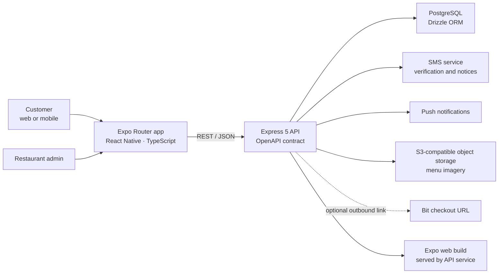

# Architecture and engineering notes

## System overview

The customer-facing app is built with Expo and React Native and is served as a web application by the API service. The same client architecture also supports native mobile builds. The Express API is the authority for authentication, menu data, order pricing, restaurant availability, and order status.

## Technology stack

| Area | Technologies |
|---|---|
| Client | TypeScript, React 19, React Native 0.81, Expo SDK 54, Expo Router |
| API | Node.js, TypeScript, Express 5 |
| Database | PostgreSQL, Drizzle ORM, `pg` |
| API contract | OpenAPI, generated TypeScript client, generated Zod schemas |
| Client state | React context, TanStack Query for server state, AsyncStorage for local persistence |
| Logging | Pino and HTTP request logging |
| Media | S3-compatible object storage for menu images |
| Operations | Railway service, GitHub-driven build and release |

## Product capabilities

### Customer ordering

Customers can browse menu categories and popular dishes, inspect item details, choose available portions and toppings, and edit a persistent cart. Checkout supports delivery or pickup, an address for delivery, and optional order notes. The restaurant's current open/closed state is visible to customers; closed restaurants cannot receive new orders.

Customer registration verifies a phone number by one-time SMS code before setting a password. Returning customers log in with their phone number and password. The client restores a saved session and validates it with the API.

Cash is the default payment method. If a Bit URL template is configured, the API can return a checkout URL for the client to open. This is an outbound link flow, not a claim that the application processes Bit payments itself.

### Restaurant administration

The admin experience is separate from customer login. It supports menu category/item maintenance, image selection, order review and status transitions, restaurant status/reporting, appearance settings, and password changes. Admin routes require the admin session.

## Database design

The Drizzle schema defines these main PostgreSQL tables:

| Table | Responsibility |
|---|---|
| `categories` | Customer-facing menu sections and display order. |
| `menu_items` | Product descriptions, category, image, prices, portion configuration, toppings, and display metadata. |
| `customers` | Customer account identity and password hash. |
| `phone_verifications` | Short-lived registration verification challenges and attempt state. |
| `customer_sessions` | Customer session-token hashes and customer association. |
| `orders` | Customer/order association, requested fulfillment, item selections, totals, payment state, and order status. |
| `daily_reports` | Daily restaurant operations, including whether new orders are accepted. |
| `settings` | Admin-controlled presentation and restaurant settings. |
| `push_subscriptions` | Registered push-notification destinations. |

Menu items are the price source of truth. On order creation, the API reloads selected items and options, validates availability and quantities, and calculates the order total on the server rather than trusting client-submitted prices.

## API endpoint groups

All paths below are mounted under `/api`.

| Method and path | Purpose |
|---|---|
| `GET /healthz` | Service health check. |
| `GET /menu/categories` | Public menu categories. |
| `GET /menu/items` | Public menu items. |
| `GET /menu/items/{id}` | A single menu item. |
| `GET /restaurant/status` | Whether the restaurant is accepting orders. |
| `POST /orders` | Create a customer order after server-side validation and repricing. |
| `GET /orders` | Admin order list. |
| `PUT /orders/{id}` | Admin order update/status transition. |
| `DELETE /orders/{id}` | Admin order deletion. |
| `POST /customer-auth/register/start` | Start customer registration and send a verification code. |
| `POST /customer-auth/register/verify` | Verify the phone challenge. |
| `POST /customer-auth/register/complete` | Finish registration and create a customer session. |
| `POST /customer-auth/login` | Customer login. |
| `GET /customer-auth/me` | Validate and return the current customer session. |
| `POST /customer-auth/logout` | Revoke the customer session. |

Admin authentication, settings, statistics, push registration, and image upload are separate protected endpoint groups.

## Technical decisions

### Shared client for web and mobile

Expo Router and React Native let the customer experience share screens, navigation, and client logic across web and native builds. The API service serves the web export so the public ordering site and API share a deployment unit.

### Server-side order validation

The client submits menu item identifiers and selections, not authoritative prices. The API rechecks menu configuration and calculates totals using current database values. This protects the order total from stale or altered client state.

### Closed-state enforcement at the API boundary

The availability check is enforced in the order-creation transaction, alongside a database lock on the daily status row. The API fails closed if status is missing or unavailable and returns a conflict when ordering is closed. The client disables the order action too, but the server remains authoritative.

### Separate customer and admin sessions

Customer registration uses phone verification and password authentication; admin access uses its own password-protected session. Customer tokens are stored hashed server-side, and the client validates persisted sessions on return.

### Contract-driven API types

OpenAPI describes the primary API surface. Generated client and Zod-schema packages keep the app's request/response types aligned with the service contract.

### External services are explicit

SMS verification/notifications, push delivery, image storage, and optional Bit checkout links are integrations, not hidden local substitutes. The documentation package includes no credentials or service configuration.

## Privacy and security considerations

- Passwords are hashed server-side; customer session tokens are stored as hashes.
- Phone verification challenges are short-lived and attempt-limited.
- Admin and customer routes use separate authentication scopes.
- Order totals and restaurant availability are validated on the server.
- The documentation package contains no app source, database snapshot, customer/order records, environment files, secrets, or internal security reports.

## Verification scope

The order-availability API test was executed successfully once. It uses isolated mocks for database, SMS, and push behavior; no production order or notification was created. A full application build/typecheck and production dependency audit were not run for this documentation export. This package does not claim a complete production security audit.
