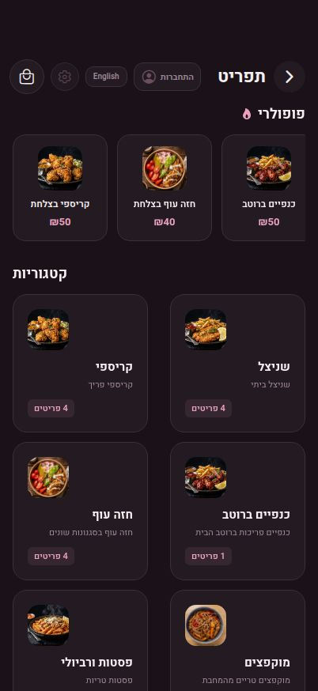
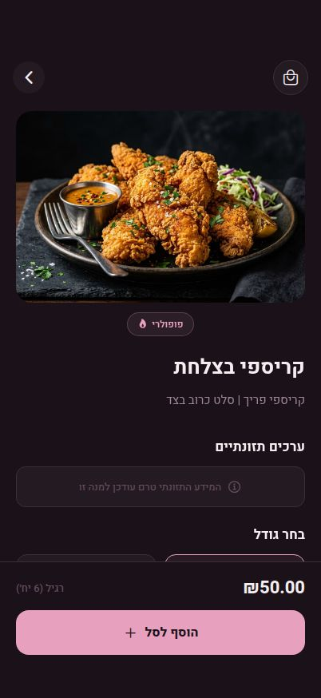
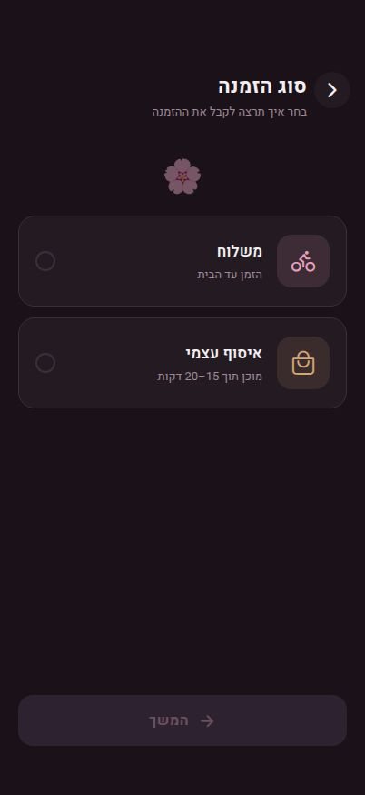
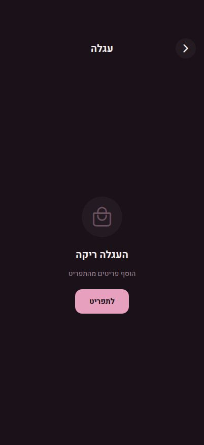
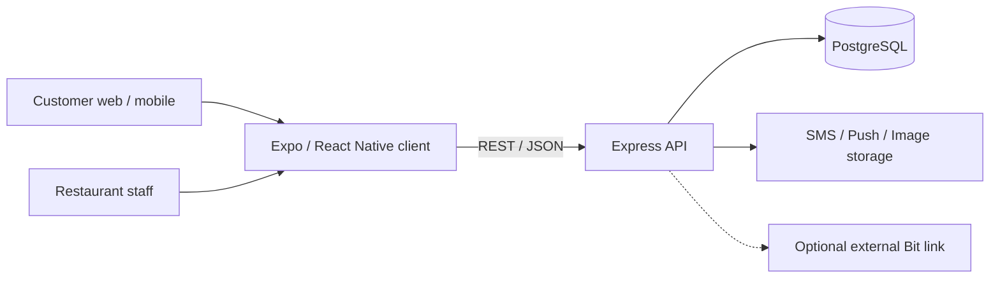

# Sakura — Restaurant Online Ordering Platform

**Production application · Full-stack engineering case study · Private source code**

[**Explore the live restaurant menu ↗**](https://sakurraa.com/menu) · [Architecture & engineering notes](ARCHITECTURE.md)

Sakura is a mobile-first restaurant ordering platform built around a **Hebrew-first, right-to-left experience**, with an English option. It brings menu browsing, item customization, delivery/pickup selection, customer accounts, and order management into one system backed by a TypeScript API and PostgreSQL.

> **Portfolio note:** This repository documents the project; it does **not** contain application source code. Screenshots show public customer-facing pages, not private customer records or completed orders.

## Product preview

| Menu | Product configuration | Category |
|:---:|:---:|:---:|
|  |  |  |

| Delivery or pickup | Cart (empty state) |
|:---:|:---:|
|  |  |

*Captured from public customer-facing screens. The cart screenshot is intentionally empty; no checkout completion is depicted.*

## What the application does

**For customers:** browse categories and popular dishes, view product details, select portions and toppings where available, manage a locally persisted cart, choose delivery or pickup, and submit an order. Registration includes phone verification; returning customers can sign in and resume a saved session. The application displays restaurant availability and supports cash payment, with an optional **external Bit checkout link** when configured.

**For restaurant staff:** use a separately authenticated administration experience to maintain categories and menu items, review and update orders, and manage restaurant availability, reports, and appearance settings.

## Technology

| Layer | Stack |
|---|---|
| Customer experience | TypeScript, React 19, React Native, Expo SDK 54, Expo Router |
| API | Node.js, TypeScript, Express 5 |
| Data | PostgreSQL, Drizzle ORM |
| Contracts | OpenAPI, generated TypeScript client and Zod schemas |
| Client state | React context, TanStack Query, AsyncStorage |
| Integrations | SMS, push notifications, S3-compatible menu-image storage, optional external Bit link |
| Deployment | Railway, GitHub-driven builds |

## Engineering decisions worth highlighting

- **Server-authoritative order totals.** The API reloads selected menu items and options, validates quantities and availability, and recalculates totals rather than trusting client-submitted prices.
- **Availability enforced beyond the UI.** Restaurant open/closed status is checked in the order-creation transaction, using a database lock on the daily status row. The UI also communicates when ordering is unavailable.
- **Separate customer and administrator access.** Customer onboarding uses phone verification and password login; protected administration has a distinct session boundary. Customer session tokens are stored hashed server-side.
- **One client architecture across platforms.** Expo Router and React Native share the customer interface and logic across the web experience and native-capable builds.
- **Contract-driven development.** An OpenAPI specification and generated client/validation schemas help align API requests and responses.

Read [**ARCHITECTURE.md**](ARCHITECTURE.md) for the data model, endpoint groups, authentication boundaries, and implementation tradeoffs.

## Verification and limitations

One isolated automated test of restaurant availability during order creation passed, with database and notification dependencies mocked. **This is not a claim of end-to-end production test coverage.** A complete application build, typecheck, and production dependency audit were not performed for this documentation export. The optional Bit link is an external checkout handoff, **not in-app payment processing**.

## About this repository

This public case study contains documentation and public customer-interface screenshots only. It deliberately excludes private source code, Git history, environment variables, production configuration, credentials, customer/order records, and internal audit material.

**Live project:** https://sakurraa.com/menu
